# 상새 (SangSae) 데이터베이스 설계서 (v1.0)
> **일상 루틴 · 장소 기반 퀘스트 · 위치 데이터 · 여행 라이프스타일 플랫폼**  
---

## 1. 개요 및 핵심 설계 원칙

### 1.1 설계 목표
1. **제3정규화(3NF) 완전 준수**: 삽입/갱신/삭제 이상을 원천 차단하고, 파생 속성(달성률, 연속 달성일, 획득 XP 등)은 메인 트랜잭션 테이블에서 분리하여 원장 로그 기반의 계산 뷰(View) 및 독립 집계 테이블로 격리.
2. **'템플릿-Fork' 모델**:
   * 공용 카탈로그/개설 루틴·퀘스트(`*_templates`)와 사용자가 내 시간표/여행에 담아 가져온 인스턴스(`user_*`)를 명확히 분리
   * 사용자는 가져온 후 자신의 일정, 시간, 장소를 자유롭게 수정할 수 있으며(`origin_template_id`로 계보 유지), 원작자의 수정에 영향받지 않음
3. **루틴의 2단계 계층 구조 (Routine Package - Task)**:
   * 루틴은 "미라클 모닝"과 같은 상위 패키지(`routines`)와 그 내부에 포함된 복수의 세부 항목(`routine_tasks`: 07:00 기상, 07:10 물마시기 등)으로 구성
   * "내 루틴에 추가(수강신청)" 시 하위 Task들이 사용자 활성 루틴으로 일괄 복제되어 타임테이블을 형성
4. **위치 유연성 (GPS Optional)**:
   * 장소 마스터(`places`)를 독립 엔티티로 분리하여 주소 및 `POINT` 공간 좌표를 관리
   * 루틴과 퀘스트 모두 `place_id`가 `NULL`을 허용하여 온라인/실내/무관 활동과 특정 장소 방문 활동을 유연하게 수용
5. **여행(`trips`) 중심의 퀘스트 일정 관리**:
   * 퀘스트는 특정 여행 일정에 배정되어 날짜별 캘린더 및 체크리스트 형태로 관리

---

## 2. 논리 ERD (Mermaid - 실제 DB v2.0 반영본)

```mermaid
erDiagram
    %% ==========================================
    %% 1. 회원 · 온보딩 · 관심사
    %% ==========================================
    users ||--|| user_profiles : "1:1 프로필/누적XP"
    users ||--o{ user_interests : "1:N 관심사 선택"
    interest_categories ||--o{ user_interests : "관심사 매핑"
    interest_categories ||--o{ interest_routine_category_map : "적합도 매핑"
    routine_categories ||--o{ interest_routine_category_map : "루틴 카테고리 연결"

    %% ==========================================
    %% 2. 장소 마스터 · 내 장소 · 여행
    %% ==========================================
    place_categories ||..o{ places : "장소 유형 코드 (논리 매핑)"
    users ||--o{ user_places : "1:N 내가 다니는 장소"
    places ||--o{ user_places : "장소 등록"
    users ||--o{ trips : "1:N 여행 일정"

    %% ==========================================
    %% 3. 퀘스트 도메인 (템플릿 - Fork - 원장)
    %% ==========================================
    users ||--o{ quest_templates : "개설/공유 (0..1)"
    places ||--o{ quest_templates : "추천 장소 (0..1)"

    users ||--o{ user_quests : "1:N 내 퀘스트 일정"
    trips ||--o{ user_quests : "여행 배정 (0..1)"
    places ||--o{ user_quests : "실천 장소 (0..1)"
    quest_templates ||--o{ user_quests : "Fork 원본 (0..1)"

    users ||--o{ user_quest_bookmarks : "1:N 퀘스트 찜(♡)"
    quest_templates ||--o{ user_quest_bookmarks : "북마크 대상"

    users ||--o{ quest_logs : "1:N 퀘스트 인증 기록"
    user_quests ||--o{ quest_logs : "완료 원장 (ON DELETE SET NULL)"

    %% ==========================================
    %% 4. 루틴 도메인 (2단계 계층 템플릿 - Fork - 원장)
    %% ==========================================
    users ||--o{ routine_templates : "개설/공개 사본 (0..1)"
    places ||--o{ routine_templates : "대표 장소 (0..1)"
    routine_templates ||--o{ routine_template_tasks : "1:N 세부 Task"
    places ||--o{ routine_template_tasks : "Task 추천 장소 (0..1)"

    routine_templates ||--o{ routine_template_categories : "1:N 다중 카테고리"
    routine_categories ||--o{ routine_template_categories : "카테고리 분류"
    routine_templates ||--o{ routine_template_tags : "1:N 자유 태그"

    users ||--o{ routine_template_bookmarks : "1:N 루틴 찜(♡)"
    routine_templates ||--o{ routine_template_bookmarks : "찜 대상"

    users ||--o{ user_routines : "1:N 내 활성 루틴"
    routine_templates ||--o{ user_routines : "Fork 원본/공개 사본 (0..1)"

    user_routines ||--o{ user_routine_tasks : "1:N 내 루틴 Task"
    places ||--o{ user_routine_tasks : "Task 실천 장소 (0..1)"
    routine_template_tasks ||--o{ user_routine_tasks : "Fork 원본 Task (0..1)"

    user_routine_tasks ||--o{ routine_task_schedules : "1:N 요일 반복 스케줄"

    users ||--o{ routine_task_logs : "1:N 루틴 실천 기록"
    user_routine_tasks ||--o{ routine_task_logs : "Task 수행 원장"

    %% ==========================================
    %% 5. 일일 요약 통계
    %% ==========================================
    users ||--o{ user_daily_aggregates : "1:N 일일 요약 집계"
    routine_task_logs }o..|| user_daily_aggregates : "배치 집계"
    quest_logs }o..|| user_daily_aggregates : "배치 집계"

    %% ==========================================
    %% 엔티티 상세 정의 (실제 DB 컬럼 동기화)
    %% ==========================================
    users {
        bigint id PK
        varchar email UK "Nullable (소셜 로그인 대응)"
        varchar password_hash "BCrypt 해시 (Nullable)"
        varchar oauth_provider "LOCAL/GOOGLE/X/APPLE"
        varchar oauth_id "소셜 고유 식별자 (UK 복합)"
        varchar status "ACTIVE/SUSPENDED/WITHDRAWN"
        datetime created_at
        datetime updated_at
    }

    user_profiles {
        bigint user_id PK "FK users"
        varchar nickname UK "1~30자 닉네임"
        varchar profile_image_url
        boolean is_location_permitted "위치권한 동의여부"
        point last_known_location "온보딩 GPS 좌표 (SRID 4326)"
        int total_xp "누적 경험치 (O(1) 조회 캐시)"
        datetime updated_at
    }

    interest_categories {
        smallint id PK
        varchar code UK "FOOD/CAFE/ACTIVITY 등 8종"
        varchar name "#맛집/#카페 등"
        smallint sort_order
    }

    user_interests {
        bigint user_id PK "FK users"
        smallint category_id PK "FK interest_categories"
        datetime created_at
    }

    interest_routine_category_map {
        smallint interest_category_id PK "FK interest_categories"
        varchar routine_category_code PK "FK routine_categories"
    }

    place_categories {
        varchar code PK "GYM/CAFE/PARK/LIBRARY/CULTURE"
        varchar name "헬스장/카페/공원 등"
        varchar emoji "아이콘 이모지"
        smallint sort_order
    }

    places {
        bigint id PK
        varchar kakao_place_id UK "카카오 장소 고유 ID (Get-or-Create)"
        varchar name "장소명"
        varchar road_address "도로명 주소"
        varchar region_1depth_name "시/도"
        varchar region_2depth_name "구/군"
        varchar region_3depth_name "동/읍/면"
        point coordinates "공간 좌표 POINT(위도 경도) SRID 4326"
        varchar category "place_categories.code 매핑"
        datetime created_at
    }

    user_places {
        bigint user_id PK "FK users"
        bigint place_id PK "FK places"
        datetime created_at
    }

    trips {
        bigint id PK
        bigint user_id FK "IDX_trips_user_date"
        varchar title "여행명"
        date start_date
        date end_date
        varchar status "PLANNED/ONGOING/COMPLETED"
        datetime created_at
        datetime updated_at
    }

    quest_templates {
        bigint id PK
        bigint creator_id FK "Nullable (기본 제공 시 NULL)"
        bigint place_id FK "Nullable (GPS 유무)"
        varchar title "퀘스트 제목"
        text description
        varchar category "테마 카테고리"
        int estimated_minutes "소요시간(분)"
        int reward_xp "보상 XP"
        varchar auth_type "NONE/PHOTO/LOCATION/TEXT"
        varchar visibility "PUBLIC/PRIVATE"
        varchar thumbnail_url
        int bookmark_count "북마크 저장 횟수"
        int completion_count "누적 완료 횟수"
        datetime created_at
    }

    user_quests {
        bigint id PK
        bigint user_id FK "IDX_user_quests_calendar"
        bigint trip_id FK "Nullable"
        bigint origin_template_id FK "Nullable (Fork 원본 계보)"
        bigint place_id FK "Nullable"
        varchar title "수정 가능한 퀘스트명"
        date scheduled_date "실천 예정일"
        time target_time "목표 시간"
        varchar auth_type "인증 방식"
        int auth_radius_m "위치 인증 허용 반경(100~1000m)"
        varchar status "TODO/COMPLETED/CANCELED"
        int reward_xp "완료 보상 XP"
        varchar memo "개인 메모"
        datetime created_at
        datetime completed_at
    }

    user_quest_bookmarks {
        bigint user_id PK "FK users"
        bigint quest_template_id PK "FK quest_templates"
        varchar folder_name "보관 폴더명"
        datetime created_at
    }

    quest_logs {
        bigint id PK
        bigint user_id FK
        bigint user_quest_id FK "Nullable (완료 후 일정 삭제 시 보존)"
        varchar title "완료 시점 퀘스트 제목 스냅샷"
        datetime completed_at
        varchar auth_type "수행된 인증 방식"
        point authenticated_location "인증 당시 GPS 좌표"
        varchar proof_image_url "사진 인증 URL"
        text proof_text "텍스트 인증 소감"
        int earned_xp "적립된 XP"
    }

    routine_categories {
        varchar code PK "EXERCISE/MIRACLE_MORNING 등 7종"
        varchar name "운동/미라클 모닝 등"
        varchar emoji "칩 이모지"
        smallint sort_order
    }

    routine_templates {
        bigint id PK
        bigint creator_id FK "Nullable (NULL=기본제공, 값=공개사본)"
        bigint representative_place_id FK "Nullable"
        varchar title "루틴 패키지명"
        text description
        varchar category "대표 카테고리 코드"
        varchar visibility "PUBLIC/PRIVATE"
        int adopted_count "담아간 횟수"
        datetime created_at
    }

    routine_template_categories {
        bigint routine_template_id PK "FK routine_templates"
        varchar category_code PK "FK routine_categories"
    }

    routine_template_tags {
        bigint routine_template_id PK "FK routine_templates"
        varchar tag PK "자유 검색 태그 (최대 5개)"
    }

    routine_template_bookmarks {
        bigint user_id PK "FK users"
        bigint routine_template_id PK "FK routine_templates"
        datetime created_at
    }

    routine_template_tasks {
        bigint id PK
        bigint routine_template_id FK
        bigint place_id FK "Nullable"
        varchar content "세부 Task 내용"
        time default_time "권장 실천 시간"
        varchar category "세부 카테고리명"
        int reward_xp "Task 보상 XP"
        smallint sort_order "패키지 내 순서"
        int allowed_radius_meters "방문 인증 허용 반경(m)"
    }

    user_routines {
        bigint id PK
        bigint user_id FK
        bigint origin_template_id FK "Nullable (Fork 원본/공개 사본)"
        varchar title "내 루틴 패키지명"
        date start_date "운영 시작일"
        date end_date "운영 종료일 (NULL=무기한)"
        boolean is_active "활성 여부 (FALSE=소프트 삭제)"
        datetime created_at
    }

    user_routine_tasks {
        bigint id PK
        bigint user_routine_id FK "IDX_tasks_user_time"
        bigint origin_template_task_id FK "Nullable (Fork 원본 Task)"
        bigint place_id FK "Nullable"
        varchar content "Task 내용"
        time target_time "타임테이블 기준 시간"
        varchar category "카테고리"
        varchar repeat_type "DAILY/WEEKDAY/WEEKEND/CUSTOM/ONCE"
        date once_date "Nullable (ONCE 1회성 실행일)"
        time alert_time "알림 시간"
        int reward_xp "완료 보상 XP"
        varchar memo "개인 메모"
        boolean is_active "활성 여부 (FALSE=소프트 삭제)"
        int allowed_radius_meters "개인 설정 인증 반경(50~1000m)"
        datetime created_at
    }

    routine_task_schedules {
        bigint id PK
        bigint user_routine_task_id FK "IDX_schedules_day_task"
        varchar day_of_week "MON/TUE/WED/THU/FRI/SAT/SUN"
    }

    routine_task_logs {
        bigint id PK
        bigint user_id FK "IDX_routine_logs_streak"
        bigint user_routine_task_id FK
        date log_date "실천 일자"
        time completed_at "완료 시각"
        point authenticated_location "인증 시점 GPS 좌표"
        int earned_xp "적립된 XP"
        boolean is_success "성공 여부"
    }

    user_daily_aggregates {
        bigint id PK
        bigint user_id FK "UK_daily_user_stat"
        date stat_date "집계 기준 일자"
        int routine_success_count
        int routine_total_count
        int quest_success_count
        int earned_xp
        int current_streak "연속 달성일수"
    }
```

---

## 3. 도메인별 상세 테이블 명세서

### [도메인 1] 회원 및 온보딩 (Membership & Onboarding)

#### 1. `users` (회원 기본 계정)
* **설명**: 회원의 인증 및 계정 상태를 관리하는 원천 테이블
* **화면 연계**: `O-00` 온보딩, `O-01` 이메일 로그인/회원가입

| 컬럼명(물리)     | 데이터 타입  | Nullable | Key |      기본값       | 설명                                           |
|:-----------------|:-------------|:--------:|:---:|:-----------------:|:-----------------------------------------------|
| `id`             | BIGINT       |    NO    | PK  |  AUTO_INCREMENT   | 회원 고유 식별자                               |
| `email`          | VARCHAR(100) |    NO    | UK  |         -         | 로그인 이메일 주소 (고유값)                    |
| `password_hash`  | VARCHAR(255) |   YES    |  -  |       NULL        | BCrypt 암호화 해시 (소셜 가입 시 NULL)         |
| `oauth_provider` | VARCHAR(20)  |    NO    |  -  |      'LOCAL'      | 가입 경로 (`LOCAL`, `GOOGLE`, `X`, `APPLE`)    |
| `oauth_id`       | VARCHAR(100) |   YES    |  -  |       NULL        | 소셜 제공자 고유 사용자 ID                     |
| `status`         | VARCHAR(20)  |    NO    |  -  |     'ACTIVE'      | 계정 상태 (`ACTIVE`, `SUSPENDED`, `WITHDRAWN`) |
| `created_at`     | DATETIME     |    NO    |  -  | CURRENT_TIMESTAMP | 가입 일시                                      |
| `updated_at`     | DATETIME     |    NO    |  -  | CURRENT_TIMESTAMP | 수정 일시 (ON UPDATE CURRENT_TIMESTAMP)        |

#### 2. `user_profiles` (회원 프로필 & 위치 권한)
* **설명**: 닉네임, 프로필 이미지, 위치 권한 및 최근 좌표 관리 (1:1 분리)
* **화면 연계**: `O-02` 프로필 설정, `O-03` 위치 권한 요청, `H-00` 헤더

| 컬럼명(물리)            | 데이터 타입  | Nullable |  Key   |      기본값       | 설명                                    |
|:------------------------|:-------------|:--------:|:------:|:-----------------:|:----------------------------------------|
| `user_id`               | BIGINT       |    NO    | PK, FK |         -         | `users.id` 참조                         |
| `nickname`              | VARCHAR(30)  |    NO    |   UK   |         -         | 사용자 닉네임 (1~30자, 공백불가)        |
| `profile_image_url`     | VARCHAR(500) |   YES    |   -    |       NULL        | 프로필 이미지 URL                       |
| `is_location_permitted` | BOOLEAN      |    NO    |   -    |       FALSE       | GPS 위치 권한 동의 여부 (`O-03`)        |
| `last_known_location`   | POINT        |   YES    |   -    |       NULL        | 최근 확인된 사용자 GPS 좌표 (SRID 4326) |
| `updated_at`            | DATETIME     |    NO    |   -    | CURRENT_TIMESTAMP | 프로필 수정 일시                        |

#### 3. `interest_categories` (관심사 8종 테마 마스터)
* **설명**: 온보딩 테마 선택 칩 8종 표준 코드 테이블
* **화면 연계**: `O-02` 관심사 테마 칩

| 컬럼명(물리) | 데이터 타입 | Nullable | Key |     기본값     | 설명                                                                                                    |
|:-------------|:------------|:--------:|:---:|:--------------:|:--------------------------------------------------------------------------------------------------------|
| `id`         | SMALLINT    |    NO    | PK  | AUTO_INCREMENT | 카테고리 식별자                                                                                         |
| `code`       | VARCHAR(30) |    NO    | UK  |       -        | 카테고리 코드 (`FOOD`, `CAFE`, `ACTIVITY`, `PHOTO`, `WALK`, `STUDY`, `CULTURE`, `NATURE`)               |
| `name`       | VARCHAR(50) |    NO    |  -  |       -        | 표시명 (`#맛집`, `#카페`, `#액티비티`, `#사진`, `#산책/조깅`, `#독서/공부`, `#문화/예술`, `#힐링/자연`) |
| `sort_order` | SMALLINT    |    NO    |  -  |       0        | 화면 노출 정렬 순서                                                                                     |

#### 4. `user_interests` (회원-관심사 매핑)
* **설명**: 회원이 선택한 관심사 목록 (0~5개 다중 선택, 교차 테이블)
* **화면 연계**: `O-02` 관심사 테마 다중 선택 (최대 5개)

| 컬럼명(물리)  | 데이터 타입 | Nullable |  Key   |      기본값       | 설명                          |
|:--------------|:------------|:--------:|:------:|:-----------------:|:------------------------------|
| `user_id`     | BIGINT      |    NO    | PK, FK |         -         | `users.id` 참조               |
| `category_id` | SMALLINT    |    NO    | PK, FK |         -         | `interest_categories.id` 참조 |
| `created_at`  | DATETIME    |    NO    |   -    | CURRENT_TIMESTAMP | 등록 일시                     |

---

### [도메인 2] 장소 및 위치 (Place & Location)

#### 5. `places` (장소 마스터)
* **설명**: GPS 기반 인증, 탐색, 추천의 기준이 되는 장소 정보
* **화면 연계**: `Q-00`, `R-00` 지도(Leaflet), 장소 핀, 근처 스팟 리스트

| 컬럼명(물리)         | 데이터 타입  | Nullable | Key |      기본값       | 설명                                                |
|:---------------------|:-------------|:--------:|:---:|:-----------------:|:----------------------------------------------------|
| `id`                 | BIGINT       |    NO    | PK  |  AUTO_INCREMENT   | 장소 식별자                                         |
| `name`               | VARCHAR(100) |    NO    |  -  |         -         | 장소명 (예: '광안리 해수욕장', '도레미파헬스장')    |
| `road_address`       | VARCHAR(255) |   YES    |  -  |       NULL        | 도로명 주소                                         |
| `region_1depth_name` | VARCHAR(50)  |    NO    |  -  |         -         | 시/도 (예: '부산광역시', '서울특별시')              |
| `region_2depth_name` | VARCHAR(50)  |    NO    |  -  |         -         | 구/군 (예: '수영구', '해운대구')                    |
| `region_3depth_name` | VARCHAR(50)  |    NO    |  -  |         -         | 동/읍/면 (예: '민락동', '우동')                     |
| `coordinates`        | POINT        |    NO    |  -  |         -         | 위경도 공간 좌표 (`POINT(위도 경도)`, SRID 4326)    |
| `category`           | VARCHAR(50)  |   YES    |  -  |       NULL        | 장소 카테고리 (`CAFE`, `GYM`, `PARK`, `LIBRARY` 등) |
| `created_at`         | DATETIME     |    NO    |  -  | CURRENT_TIMESTAMP | 등록 일시                                           |

---

### [도메인 3] 여행 (Trip Management)

#### 6. `trips` (사용자 여행 일정)
* **설명**: 사용자의 여행 일정 및 상태 관리 (퀘스트가 배정되는 상위 컨테이너)
* **화면 연계**: `H-00` 내 여행 관리 카드, `Q-00` 여행 헤더 및 여행 선택/전환 모달

| 컬럼명(물리) | 데이터 타입  | Nullable | Key |      기본값       | 설명                                                              |
|:-------------|:-------------|:--------:|:---:|:-----------------:|:------------------------------------------------------------------|
| `id`         | BIGINT       |    NO    | PK  |  AUTO_INCREMENT   | 여행 고유 식별자                                                  |
| `user_id`    | BIGINT       |    NO    | FK  |         -         | `users.id` 참조                                                   |
| `title`      | VARCHAR(100) |    NO    |  -  |         -         | 여행명 (예: '부산 여행', '제주 힐링 여행')                        |
| `start_date` | DATE         |    NO    |  -  |         -         | 여행 시작 일자                                                    |
| `end_date`   | DATE         |    NO    |  -  |         -         | 여행 종료 일자                                                    |
| `status`     | VARCHAR(20)  |    NO    |  -  |     'PLANNED'     | 진행 상태 (`PLANNED`: 예정, `ONGOING`: 진행중, `COMPLETED`: 완료) |
| `created_at` | DATETIME     |    NO    |  -  | CURRENT_TIMESTAMP | 등록 일시                                                         |
| `updated_at` | DATETIME     |    NO    |  -  | CURRENT_TIMESTAMP | 수정 일시                                                         |

---

### [도메인 4] 퀘스트 (Quest Domain - Fork 모델)

#### 7. `quest_templates` (공용 퀘스트 원본 템플릿)
* **설명**: 탐색 화면에 노출되는 공용 퀘스트 원본 (사용자가 생성한 전체공개 퀘스트 포함)
* **화면 연계**: `Q-00` 퀘스트 탐색 (인기/최신/추천 퀘스트 카드)

| 컬럼명(물리)        | 데이터 타입  | Nullable | Key |      기본값       | 설명                                                                          |
|:--------------------|:-------------|:--------:|:---:|:-----------------:|:------------------------------------------------------------------------------|
| `id`                | BIGINT       |    NO    | PK  |  AUTO_INCREMENT   | 퀘스트 원본 식별자                                                            |
| `creator_id`        | BIGINT       |    NO    | FK  |         -         | 개설자 `users.id` 참조                                                        |
| `place_id`          | BIGINT       |   YES    | FK  |       NULL        | 장소 `places.id` 참조 (GPS 미사용 퀘스트는 NULL)                              |
| `title`             | VARCHAR(150) |    NO    |  -  |         -         | 퀘스트 제목 (예: '광안리에서 일몰 사진 남기기')                               |
| `description`       | TEXT         |   YES    |  -  |       NULL        | 퀘스트 상세 설명 및 수행 방법                                                 |
| `category`          | VARCHAR(50)  |    NO    |  -  |         -         | 테마 카테고리 (`PHOTO`, `FOOD`, `CAFE`, `WALK`, `ACTIVITY`)                   |
| `estimated_minutes` | INT          |    NO    |  -  |        30         | 예상 소요 시간 (분 단위, 예: 15, 30, 60)                                      |
| `reward_xp`         | INT          |    NO    |  -  |        100        | 완료 시 획득 XP                                                               |
| `auth_type`         | VARCHAR(20)  |    NO    |  -  |      'NONE'       | 인증 방식 (`NONE`: 단순체크, `PHOTO`: 사진, `LOCATION`: 위치, `TEXT`: 텍스트) |
| `visibility`        | VARCHAR(20)  |    NO    |  -  |     'PUBLIC'      | 공개 설정 (`PUBLIC`: 전체공개, `PRIVATE`: 나만보기)                           |
| `thumbnail_url`     | VARCHAR(500) |   YES    |  -  |       NULL        | 카드 썸네일 이미지 URL                                                        |
| `bookmark_count`    | INT          |    NO    |  -  |         0         | 북마크(♡) 저장 횟수 (탐색 정렬용)                                            |
| `created_at`        | DATETIME     |    NO    |  -  | CURRENT_TIMESTAMP | 생성 일시                                                                     |

#### 8. `user_quests` (내 일정/여행에 담은 퀘스트 - Fork 인스턴스)
* **설명**: 사용자가 템플릿에서 '담기(add)'하거나 직접 생성한 개인 실천 퀘스트
* **화면 연계**: `Q-00` 여행 관리 탭 (오늘의 퀘스트 리스트, 주간 캘린더)

| 컬럼명(물리)         | 데이터 타입  | Nullable | Key |      기본값       | 설명                                                            |
|:---------------------|:-------------|:--------:|:---:|:-----------------:|:----------------------------------------------------------------|
| `id`                 | BIGINT       |    NO    | PK  |  AUTO_INCREMENT   | 내 퀘스트 식별자                                                |
| `user_id`            | BIGINT       |    NO    | FK  |         -         | 수행 사용자 `users.id` 참조                                     |
| `trip_id`            | BIGINT       |   YES    | FK  |       NULL        | 소속 여행 `trips.id` 참조 (일반 퀘스트는 NULL 가능)             |
| `origin_template_id` | BIGINT       |   YES    | FK  |       NULL        | 원본 `quest_templates.id` 참조 (직접 생성 시 NULL, 계보 추적)   |
| `place_id`           | BIGINT       |   YES    | FK  |       NULL        | 실천 장소 `places.id` 참조 (수정 가능, GPS 미사용 시 NULL)      |
| `title`              | VARCHAR(150) |    NO    |  -  |         -         | 퀘스트 제목 (사용자가 개별 수정 가능)                           |
| `scheduled_date`     | DATE         |    NO    |  -  |         -         | 실천 예정 일자 (캘린더 연동 기준일)                             |
| `target_time`        | TIME         |   YES    |  -  |       NULL        | 목표 수행 시간                                                  |
| `auth_type`          | VARCHAR(20)  |    NO    |  -  |      'NONE'       | 인증 요구 방식 (`NONE`, `PHOTO`, `LOCATION`, `TEXT`)            |
| `status`             | VARCHAR(20)  |    NO    |  -  |      'TODO'       | 상태 (`TODO`: 예정/진행중, `COMPLETED`: 완료, `CANCELED`: 취소) |
| `reward_xp`          | INT          |    NO    |  -  |        100        | 완료 시 획득할 XP                                               |
| `memo`               | VARCHAR(255) |   YES    |  -  |       NULL        | 사용자 개인 메모                                                |
| `created_at`         | DATETIME     |    NO    |  -  | CURRENT_TIMESTAMP | 담은 일시                                                       |
| `completed_at`       | DATETIME     |   YES    |  -  |       NULL        | 최종 완료 일시                                                  |

#### 9. `user_quest_bookmarks` (내 퀘스트 컬렉션 보관함)
* **설명**: 퀘스트 카드에서 '♡ 저장'을 누른 관심 퀘스트 목록
* **화면 연계**: `Q-00` 내 컬렉션 모달 (폴더별 조회/관리)

| 컬럼명(물리)        | 데이터 타입 | Nullable |  Key   |      기본값       | 설명                      |
|:--------------------|:------------|:--------:|:------:|:-----------------:|:--------------------------|
| `user_id`           | BIGINT      |    NO    | PK, FK |         -         | `users.id` 참조           |
| `quest_template_id` | BIGINT      |    NO    | PK, FK |         -         | `quest_templates.id` 참조 |
| `folder_name`       | VARCHAR(50) |    NO    |   -    |      '기본'       | 보관 폴더명               |
| `created_at`        | DATETIME    |    NO    |   -    | CURRENT_TIMESTAMP | 저장 일시                 |

---

### [도메인 5] 루틴 (Routine Domain - 2단계 Fork 수강신청 모델)

#### 10. `routine_templates` (공용 루틴 패키지 원본 템플릿)
* **설명**: 탐색 화면에 개설된 루틴 패키지 원본
* **화면 연계**: `R-00` 루틴 탐색 (인기/추천 루틴 카드, 루틴 상세 모달)

| 컬럼명(물리)              | 데이터 타입  | Nullable | Key |      기본값       | 설명                                                    |
|:--------------------------|:-------------|:--------:|:---:|:-----------------:|:--------------------------------------------------------|
| `id`                      | BIGINT       |    NO    | PK  |  AUTO_INCREMENT   | 루틴 템플릿 식별자                                      |
| `creator_id`              | BIGINT       |    NO    | FK  |         -         | 개설자 `users.id` 참조                                  |
| `representative_place_id` | BIGINT       |   YES    | FK  |       NULL        | 대표 추천 장소 `places.id` 참조 (GPS 미사용 시 NULL)    |
| `title`                   | VARCHAR(100) |    NO    |  -  |         -         | 루틴 패키지명 (예: '아침 조깅 루틴')                    |
| `description`             | TEXT         |   YES    |  -  |       NULL        | 루틴 소개 및 효과                                       |
| `category`                | VARCHAR(50)  |    NO    |  -  |         -         | 대표 카테고리 (`EXERCISE`, `GROWTH`, `HEALTH`, `STUDY`) |
| `visibility`              | VARCHAR(20)  |    NO    |  -  |     'PUBLIC'      | 공개 설정 (`PUBLIC`: 전체공개, `PRIVATE`: 나만보기)     |
| `adopted_count`           | INT          |    NO    |  -  |         0         | '내 루틴에 추가(수강신청)' 횟수                         |
| `created_at`              | DATETIME     |    NO    |  -  | CURRENT_TIMESTAMP | 개설 일시                                               |

#### 11. `routine_template_tasks` (원본 루틴 세부 Task)
* **설명**: 템플릿 패키지에 기본 구성된 세부 실천 항목들 (1:N)
* **화면 연계**: `R-00` 루틴 상세 모달 내 Task 목록

| 컬럼명(물리)          | 데이터 타입  | Nullable | Key |     기본값     | 설명                                                |
|:----------------------|:-------------|:--------:|:---:|:--------------:|:----------------------------------------------------|
| `id`                  | BIGINT       |    NO    | PK  | AUTO_INCREMENT | 템플릿 Task 식별자                                  |
| `routine_template_id` | BIGINT       |    NO    | FK  |       -        | 소속 루틴 `routine_templates.id` 참조               |
| `place_id`            | BIGINT       |   YES    | FK  |      NULL      | Task별 추천 장소 `places.id` 참조 (선택사항)        |
| `content`             | VARCHAR(150) |    NO    |  -  |       -        | 세부 Task 내용 (예: '물 500ml 마시기', '조깅 30분') |
| `default_time`        | TIME         |    NO    |  -  |   '07:00:00'   | 권장 실천 시간                                      |
| `category`            | VARCHAR(50)  |    NO    |  -  |       -        | 세부 카테고리                                       |
| `sort_order`          | SMALLINT     |    NO    |  -  |       1        | 패키지 내 순서                                      |

#### 12. `user_routines` (내 활성 루틴 패키지 - Fork 인스턴스)
* **설명**: 사용자가 '내 루틴에 추가'하거나 직접 만든 활성 루틴 패키지
* **화면 연계**: `H-00` 내 루틴 관리 카드, `R-00` 활성 루틴 선택 셀렉트박스

| 컬럼명(물리)         | 데이터 타입  | Nullable | Key |      기본값       | 설명                                         |
|:---------------------|:-------------|:--------:|:---:|:-----------------:|:---------------------------------------------|
| `id`                 | BIGINT       |    NO    | PK  |  AUTO_INCREMENT   | 내 루틴 패키지 식별자                        |
| `user_id`            | BIGINT       |    NO    | FK  |         -         | 소유 사용자 `users.id` 참조                  |
| `origin_template_id` | BIGINT       |   YES    | FK  |       NULL        | 원본 `routine_templates.id` 참조 (Fork 계보) |
| `title`              | VARCHAR(100) |    NO    |  -  |         -         | 내 루틴명 (사용자 임의 수정 가능)            |
| `start_date`         | DATE         |    NO    |  -  |         -         | 운영 시작 일자                               |
| `end_date`           | DATE         |   YES    |  -  |       NULL        | 운영 종료 일자 (NULL이면 무기한)             |
| `is_active`          | BOOLEAN      |    NO    |  -  |       TRUE        | 활성화 여부 (필터링 기준)                    |
| `created_at`         | DATETIME     |    NO    |  -  | CURRENT_TIMESTAMP | 등록 일시                                    |

#### 13. `user_routine_tasks` (내 루틴 세부 Task - 타임테이블 항목)
* **설명**: 사용자 루틴에 속한 실제 실행 Task (시간, 장소, 알림 설정 및 개별 수정 가능)
* **화면 연계**: `R-00` 타임테이블 목록 및 Task 설정 폼(등록/수정/삭제)

| 컬럼명(물리)              | 데이터 타입  | Nullable | Key |      기본값       | 설명                                                        |
|:--------------------------|:-------------|:--------:|:---:|:-----------------:|:------------------------------------------------------------|
| `id`                      | BIGINT       |    NO    | PK  |  AUTO_INCREMENT   | 내 Task 식별자                                              |
| `user_routine_id`         | BIGINT       |    NO    | FK  |         -         | 소속 루틴 `user_routines.id` 참조                           |
| `origin_template_task_id` | BIGINT       |   YES    | FK  |       NULL        | 원본 Task `routine_template_tasks.id` 참조                  |
| `place_id`                | BIGINT       |   YES    | FK  |       NULL        | 실천 장소 `places.id` 참조 (GPS 미사용 시 NULL)             |
| `content`                 | VARCHAR(150) |    NO    |  -  |         -         | Task 내용 (예: '헬스장 가서 하체 운동')                     |
| `target_time`             | TIME         |    NO    |  -  |    '07:00:00'     | 타임테이블 정렬 기준 시간 (예: 07:00 AM)                    |
| `category`                | VARCHAR(50)  |    NO    |  -  |         -         | 카테고리 (`운동`, `자기계발`, `건강`, `공부`)               |
| `repeat_type`             | VARCHAR(20)  |    NO    |  -  |      'DAILY'      | 반복 유형 (`DAILY`, `WEEKDAY`, `WEEKEND`, `CUSTOM`, `ONCE`) |
| `alert_time`              | TIME         |   YES    |  -  |       NULL        | 푸시 알림 희망 시간                                         |
| `memo`                    | VARCHAR(255) |   YES    |  -  |       NULL        | 개인 메모                                                   |
| `is_active`               | BOOLEAN      |    NO    |  -  |       TRUE        | 활성 여부                                                   |
| `created_at`              | DATETIME     |    NO    |  -  | CURRENT_TIMESTAMP | 생성 일시                                                   |

#### 14. `routine_task_schedules` (Task별 요일 반복 스케줄 - 1:N 정규화)
* **설명**: 요일별 반복 매핑 테이블
* **화면 연계**: `R-00` Task 설정 폼의 기간/반복 설정 (매일, 평일, 주말, 특정 요일)

| 컬럼명(물리)           | 데이터 타입 | Nullable | Key |     기본값     | 설명                                                        |
|:-----------------------|:------------|:--------:|:---:|:--------------:|:------------------------------------------------------------|
| `id`                   | BIGINT      |    NO    | PK  | AUTO_INCREMENT | 스케줄 식별자                                               |
| `user_routine_task_id` | BIGINT      |    NO    | FK  |       -        | `user_routine_tasks.id` 참조                                |
| `day_of_week`          | VARCHAR(3)  |    NO    |  -  |       -        | 반복 요일 (`MON`, `TUE`, `WED`, `THU`, `FRI`, `SAT`, `SUN`) |

---

### [도메인 6] 수행 로그 (Execution Logs - 3NF 원장)

#### 15. `routine_task_logs` (루틴 Task 실천 원장)
* **설명**: 사용자가 당일 체크박스로 완료 처리한 1회성 실천 기록
* **화면 연계**: `H-00`, `R-00` 오늘 할 일 체크박스 완료 이벤트

| 컬럼명(물리)             | 데이터 타입 | Nullable | Key |     기본값     | 설명                                             |
|:-------------------------|:------------|:--------:|:---:|:--------------:|:-------------------------------------------------|
| `id`                     | BIGINT      |    NO    | PK  | AUTO_INCREMENT | 로그 식별자                                      |
| `user_id`                | BIGINT      |    NO    | FK  |       -        | `users.id` 참조                                  |
| `user_routine_task_id`   | BIGINT      |    NO    | FK  |       -        | `user_routine_tasks.id` 참조                     |
| `log_date`               | DATE        |    NO    |  -  |       -        | 실천 일자 (연속 달성일 산출 기준)                |
| `completed_at`           | TIME        |    NO    |  -  |       -        | 완료 처리 시각                                   |
| `authenticated_location` | POINT       |   YES    |  -  |      NULL      | 인증 시점의 사용자 GPS 좌표 (GPS 루틴일 때 기록) |
| `is_success`             | BOOLEAN     |    NO    |  -  |      TRUE      | 성공 여부                                        |

#### 16. `quest_logs` (퀘스트 완료 및 인증 원장)
* **설명**: 퀘스트 인증(사진, 위치, 텍스트) 완료 및 XP 획득 기록
* **화면 연계**: `Q-00` 퀘스트 인증 모달 제출 완료 이벤트

| 컬럼명(물리)             | 데이터 타입  | Nullable | Key |      기본값       | 설명                                                   |
|:-------------------------|:-------------|:--------:|:---:|:-----------------:|:-------------------------------------------------------|
| `id`                     | BIGINT       |    NO    | PK  |  AUTO_INCREMENT   | 로그 식별자                                            |
| `user_id`                | BIGINT       |    NO    | FK  |         -         | `users.id` 참조                                        |
| `user_quest_id`          | BIGINT       |    NO    | FK  |         -         | `user_quests.id` 참조                                  |
| `completed_at`           | DATETIME     |    NO    |  -  | CURRENT_TIMESTAMP | 인증 완료 일시                                         |
| `auth_type`              | VARCHAR(20)  |    NO    |  -  |      'NONE'       | 수행된 인증 방식 (`NONE`, `PHOTO`, `LOCATION`, `TEXT`) |
| `authenticated_location` | POINT        |   YES    |  -  |       NULL        | 위치 인증 시 획득한 GPS 좌표                           |
| `proof_image_url`        | VARCHAR(500) |   YES    |  -  |       NULL        | 사진 인증 시 업로드된 이미지 URL                       |
| `proof_text`             | TEXT         |   YES    |  -  |       NULL        | 텍스트 인증 시 작성한 한줄 소감                        |
| `earned_xp`              | INT          |    NO    |  -  |        100        | 적립된 XP (중복 적립 방지 원장)                        |

---

### [도메인 7] 마이페이지/홈 집계 및 통계 (3NF 완전 분리)

#### 17. `v_user_home_dashboard` (홈 대시보드 통계 실시간 계산 뷰)
* **객체 유형**: Database VIEW (가상 뷰)
* **목적**: 3NF 원칙을 지키면서 `H-00` 홈 대시보드 카드의 5대 지표를 실시간 계산 제공
* **원천 테이블**: `trips`, `user_quests`, `user_routines`, `user_routine_tasks`, `routine_task_logs`, `quest_logs`

| 출력 필드명             | 데이터 타입 | 설명 / 산출 수식                                                         |
|:------------------------|:------------|:-------------------------------------------------------------------------|
| `user_id`               | BIGINT      | 사용자 식별자                                                            |
| `ongoing_trip_count`    | INT         | 현재 진행 중인 여행 수 (`status = 'ONGOING'`)                            |
| `active_routine_count`  | INT         | 활성 루틴 패키지 수 (`is_active = TRUE`)                                 |
| `completed_quest_count` | INT         | 달성한 퀘스트 총 개수 (`quest_logs` 기반 `COUNT`)                        |
| `remaining_quest_count` | INT         | 예정된 남은 퀘스트 수 (`user_quests`의 `status = 'TODO'`)                |
| `today_done_tasks`      | INT         | 오늘 완료한 루틴 할 일 수 (`routine_task_logs`의 `log_date = CURDATE()`) |
| `today_remaining_tasks` | INT         | 오늘 남은 루틴 할 일 수 (오늘 예정 Task 수 - 완료 수)                    |
| `total_earned_xp`       | INT         | 총 누적 획득 XP (`quest_logs.earned_xp`의 `SUM`)                         |

#### 18. `user_daily_aggregates` (일일/누적 요약 집계 테이블)
* **테이블 유형**: 집계/요약 테이블
* **원천 소스**: `routine_task_logs`, `quest_logs`
* **갱신 방식**: 매일 자정(00:05) 배치 집계 (Batch Aggregation Job) 또는 이벤트 발행

| 컬럼명(물리)            | 데이터 타입 | Nullable | Key | 집계 산출 수식 / 설명                 |
|:------------------------|:------------|:--------:|:---:|:--------------------------------------|
| `id`                    | BIGINT      |    NO    | PK  | 고유 식별자                           |
| `user_id`               | BIGINT      |    NO    | FK  | 사용자 `users.id` 참조                |
| `stat_date`             | DATE        |    NO    |  -  | 집계 기준 일자                        |
| `routine_success_count` | INT         |    NO    |  -  | 당일 루틴 Task 성공 횟수              |
| `routine_total_count`   | INT         |    NO    |  -  | 당일 실천 대상 전체 루틴 Task 수      |
| `quest_success_count`   | INT         |    NO    |  -  | 당일 완료한 퀘스트 수                 |
| `earned_xp`             | INT         |    NO    |  -  | 당일 획득한 총 XP                     |
| `current_streak`        | INT         |    NO    |  -  | 당일 기준 연속 달성일수 (Streak Days) |

---

## 4. 인덱스 명세서 (Index Specifications)

화면설계서의 **"지도 반경 3km 검색"**, **"오늘의 타임테이블 순서 조회"**, **"주간 캘린더 일자별 닷(Dot) 카운트"** 요구사항을 만족시키기는 인덱스

| 테이블명                 | 인덱스명                   | 종류         | 대상 컬럼 (순서 중요)                               | 용도 및 화면 연계                                                            |
|:-------------------------|:---------------------------|:-------------|:----------------------------------------------------|:-----------------------------------------------------------------------------|
| `users`                  | `uk_users_email`           | Unique       | `email`                                             | 이메일 중복확인 및 로그인 고속화 (`O-01`)                                    |
| `user_profiles`          | `uk_profiles_nickname`     | Unique       | `nickname`                                          | 닉네임 중복확인 (`O-02`)                                                     |
| `places`                 | `sp_places_coordinates`    | **Spatial**  | `coordinates`                                       | **반경 3km 근처 장소/루틴 공간 검색** (`ST_Distance_Sphere`, `Q-00`, `R-00`) |
| `trips`                  | `idx_trips_user_date`      | Normal(복합) | `user_id ASC, start_date ASC`                       | 사용자별 여행 목록 및 현재 진행중 여행 조회 (`H-00`, `Q-00`)                 |
| `quest_templates`        | `idx_quest_tpl_search`     | Normal(복합) | `visibility ASC, category ASC, bookmark_count DESC` | 탐색 탭 인기순/카테고리별 퀘스트 정렬 조회 (`Q-00`)                          |
| `user_quests`            | `idx_user_quests_calendar` | Normal(복합) | `user_id ASC, scheduled_date ASC, status ASC`       | **주간 캘린더 날짜별 퀘스트 및 닷(dot) 유무 조회** (`Q-00`)                  |
| `routine_templates`      | `idx_routine_tpl_lookup`   | Normal(복합) | `visibility ASC, category ASC, adopted_count DESC`  | HOT 루틴 추천 및 탐색 그리드 정렬 (`R-00`)                                   |
| `user_routine_tasks`     | `idx_tasks_user_time`      | Normal(복합) | `user_routine_id ASC, target_time ASC`              | **타임테이블 시간순(07:00 AM 순) 정렬 출력** (`R-00`)                        |
| `routine_task_schedules` | `idx_schedules_day_task`   | Normal(복합) | `day_of_week ASC, user_routine_task_id ASC`         | 특정 요일(화요일 등) 실천 대상 Task 고속 필터링                              |
| `routine_task_logs`      | `idx_routine_logs_streak`  | Normal(복합) | `user_id ASC, log_date DESC, is_success ASC`        | **연속 달성일(Streak) 및 일간 달성률 산출** (`H-00`, `R-00`)                 |
| `quest_logs`             | `idx_quest_logs_user`      | Normal(복합) | `user_id ASC, completed_at DESC`                    | 총 달성 퀘스트 수 및 누적 XP 집계 (`H-00`)                                   |
| `user_daily_aggregates`  | `uk_daily_user_stat`       | Unique(복합) | `user_id ASC, stat_date DESC`                       | 마이페이지 일별 통계 고속 조회 및 중복 집계 방지                             |
